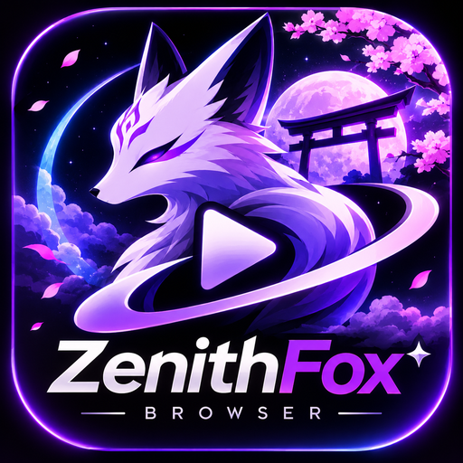

<div align="center">
  

  <h1>ZenithFox Browser</h1>

  <p>
    <strong>A fast, privacy-first Android browser built on Mozilla GeckoView & Jetpack Compose — engineered for crisp 4K anime & web video enhancement, smooth GPU frame generation, effortless video downloading, and zero-clutter streaming.</strong>
  </p>

  <p>
    
    
    
    
  </p>
</div>

---

## ✨ Key Features

### 🎬 Real-Time 4K Video Enhancement & GPU Frame Generation
- **High-Precision (FP32) WebGL2 Anime4K + AMD FidelityFX CAS**: Sharpens blurry 720p/1080p streams up to crisp 4K with directional ink-line thinning, edge-preserving bilateral compression denoise, sky anti-banding, and luma-preserving HDR cel color pop.
- **GPU Optical-Flow Frame Generation (MCFI)**: Smooth bidirectional Lucas-Kanade motion interpolation with selectable **30 / 45 / 60 / 90 / 120 FPS** targets, automatic scene-cut ghosting protection, and adaptive GPU thermal/frame-time safeguards.
- **Live Before / After Split Compare**: Toggle an interactive split-screen divider to compare raw video against the 4K-enhanced output in real time.
- **Zero-Glitch Automatic Safeguards**: Continuous pixel health monitoring with automatic Direct → Canvas2D-Staging → Safe WebRender GPU fallback guarantees zero black or pink screens on any Mali, Adreno, Xclipse, or PowerVR GPU.
- **Real-Time FPS Telemetry**: Accurately tracks live decoded Source FPS (via MediaCodec `getVideoPlaybackQuality()`) and shader Output FPS in both normal and fullscreen views.

### 📐 Non-Blocking Fullscreen & True Video Scaling
- **Native Web Player Compatibility**: Uses a compact, auto-collapsing **Fullscreen Tools Corner Pill** so 99% of the screen stays untouched — tap play/pause, seek, subtitles, and quality controls directly on YouTube or any anime site without obstruction.
- **Universal Aspect Scaling**: Switch seamlessly between **Fit**, **Fill (Crop)**, **Stretch (Edge-to-Edge)**, **Zoom (1.25×)**, **Custom Zoom (0.5×–3.0×)**, and **Original** across inline players, YouTube, and embedded fullscreen iframes on 16:9, 20:9, and 21:9 screens.
- **Picture-in-Picture & Force Fullscreen**: Pop out videos into Android PiP or force fullscreen on players that hide their fullscreen button.

### ⬇️ Smart Video-Only Downloader
- **Clean Video Detection**: Automatically captures real playing **HLS (`.m3u8`)** and **direct MP4 / WebM** video streams while filtering out webpage HTML, ads, scripts, and stray subtitle fragments.
- **Quality & Estimated File Size**: Parses HLS master playlists to display selectable resolutions (**1080p / 720p / 480p / 360p**) alongside estimated file sizes in MB/GB before you download.
- **Built-In Download Manager**: Track active downloads with live progress, pause/cancel/retry controls, and quick open/delete actions.

### 🛡️ Built-In Ad, Tracker & Redirect Shield
- **Network + Cosmetic Blocking**: Built-in GeckoView WebExtension blocks ad networks, trackers, pop-unders, and malicious redirect chains before they open.
- **Custom Rules & Per-Site Whitelist**: Manage custom block domains, inspect recently blocked requests, and whitelist trusted sites in the **Privacy Dashboard**.
- **Instant Background Audio Stop**: Returning to the ZenithFox Home screen or switching tabs cleanly stops background video playback so audio never keeps playing invisibly.

### 🎨 ZenithFox Cosmic Material 3 UI
- **Signature Theme & AMOLED Mode**: Crafted with deep cosmic obsidian surfaces, electric violet accents, and sakura highlights — plus **AMOLED Black**, **Dark**, **Light**, and **Material You Dynamic Color** support.
- **Full Browser Toolkit**: Multi-tab switcher with Private Tabs & tab groups, Bookmarks, History, Reader Mode, Find in Page, Page Translation, Desktop Site toggle, QR Code sharing, and customizable Home shortcuts.

---

## 📲 How to Download & Install (Android)

ZenithFox Browser works on **any 64-bit Android phone (`arm64-v8a`, Android 7.0 – Android 16+)** and ships as a compact ~90 MB APK.

### Option 1: Download from GitHub Releases (Recommended)
1. Go to the [**Releases**](../../releases) section on the right side of this repository.
2. Under the latest release (**v1.6.0**), download **`ZenithFoxBrowser.apk`** (or `app-debug.apk` / `app-release.apk`).
3. Open the downloaded `.apk` file on your Android device.
4. If prompted, enable **Install unknown apps** for your browser or file manager.
5. Tap **Install** and launch **ZenithFox Browser**!

### Option 2: Download Latest Build from GitHub Actions
1. Open the [**Actions**](../../actions) tab at the top of this repository.
2. Click the latest green ✅ run of **Build ZenithFox Browser Debug APK**.
3. Scroll down to **Artifacts** and download **`ZenithFoxBrowser-debug-apk`**.
4. Extract the `.zip` archive on your phone and install the `.apk` inside.

---

## 💡 Quick Tips After Installing
- **4K Upscaling & Frame Gen**: Start playing any video, tap the floating tune button (or the top-right **Tools pill** in fullscreen), and pick **Anime 4K Ultra**, **4K Crisp Sharpen**, or toggle **Frame Generation**.
- **Video Scaling on Tall Phones (20:9 / 21:9)**: In fullscreen, tap the top-right pill and cycle to **Fill** (removes black bars with zero distortion) or **Stretch** (edge-to-edge full screen).
- **Live FPS HUD**: Enable **Live Performance HUD** in **Settings** to see real-time display Hz, RAM, thermal status, and live video Source/Output FPS in both portrait and fullscreen modes.
- **Note on DRM Streams**: Widevine/DRM-encrypted platforms (such as Netflix or Crunchyroll DRM streams) restrict GPU pixel access at the OS level; ZenithFox Browser automatically detects DRM and cleanly preserves native playback + video scaling without black screens.

---

## 🛠️ Building from Source

### Requirements
- **JDK 21**
- **Android SDK** (`compileSdk 36`, `minSdk 24`)
- **Gradle 9.3.1** (or GitHub Actions)

### Build Commands
```bash
# Run unit tests
gradle :app:testDebugUnitTest

# Build compact arm64-v8a Debug APK
gradle :app:assembleDebug

# Output APK path:
# app/build/outputs/apk/debug/app-debug.apk
```

### Signed Release Builds via GitHub Actions
Add `KEYSTORE_BASE64`, `STORE_PASSWORD`, and `KEY_PASSWORD` to **Settings → Secrets and variables → Actions**, then manually trigger the **Build ZenithFox Browser Signed Release APK** workflow from the **Actions** tab.

---

## 🧱 Tech Stack & Architecture
- **Browser Engine**: Mozilla GeckoView 140 (`org.mozilla.geckoview:geckoview-arm64-v8a`)
- **UI Framework**: Kotlin + Jetpack Compose + Material Design 3
- **GPU Shaders**: Custom Single-Pass FP32 WebGL2 / WebGL1 GLSL ES 3.00 (`anime_enhancer` Built-In WebExtension)
- **Network Shield & Sniffer**: Built-In WebExtensions (`anime_adblock`, `anime_downloader`)
- **Local Storage**: Room Database + Jetpack DataStore (100% on-device privacy — zero telemetry servers)
- **Networking**: OkHttp 4 (HLS manifest & video size probing)

---

<div align="center">
  <sub>Built with ❤️ for crisp anime & web streaming on Android.</sub>
</div>
